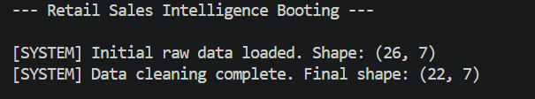
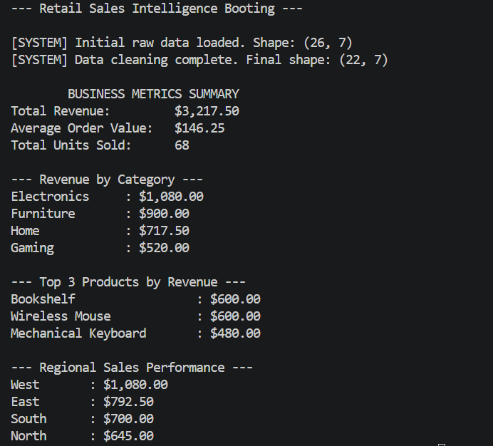

# Retail Sales Intelligence
### IEEE LGU AI/ML Cohort One - Fall 2026
**Week 3 Assignment:** Data Analysis with NumPy & Pandas
**AI/ML Leads:** Abdullah Faisal & Alina Irshad

## 1. Project Overview
This project analyzes a raw, corrupted retail sales dataset to generate business intelligence metrics. By processing the data, the tool successfully isolates top-selling products, computes regional sales performance, and calculates the overall Average Order Value (AOV).

## 2. Key Concepts Implemented
- Pandas DataFrame Loading & Cleaning (`read_csv`, `fillna`, `dropna`, `drop_duplicates`)
- NumPy Statistical Calculations (Mean, Median, Standard Deviation, Sums)
- Data Grouping & Aggregation (`groupby`)
- onditional Filtering & Indexing

## 3. How to Run the Program
python main.py

## 4. Dataset Information & Cleaning Decisions
Data Source: A custom .csv dataset representing 26 hardware, furniture, and gaming transactions.

Missing Values & Cleaning:
drop_duplicates() was used to remove accidental double-charges (duplicate order_id).
pd.to_numeric(errors='coerce') was used to catch text strings typed into integer columns.

Unrecoverable transaction rows with missing quantities were dropped (dropna), while missing unit prices were imputed (fillna) using the dataset's median price to preserve the sales volume data.

## 5. Execution Screenshots & Proof

### Data Cleaning Proof
The program successfully loads the raw data and drops corrupted/duplicate records (reducing the dataset from 26 to 22 valid rows

### Business Metrics Report
The final generated business intelligence metrics using NumPy and Pandas groupby.
